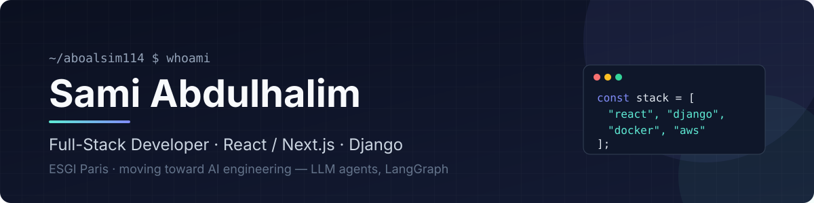

  

  
  
  

I build full-stack web apps with **React / Next.js** and **Django**, ship them with **Docker** on **AWS**, and I'm now focused on **AI engineering**: LLM agents with **LangGraph** and local models.

4th-year Master's student in Web Engineering at **ESGI Paris** (work-study) · based in Paris.

  

## Featured work

**[Strike Shop](https://github.com/aboalsim114/Strike_Shop)** · [API](https://github.com/aboalsim114/Strike_Shop_API) — mobile e-commerce app
 React Native (Expo) · TypeScript · Redux Toolkit · Stripe · Django 
Full purchase flow: auth, catalog, reviews, persisted cart, Stripe card payments and order history, with one Redux slice per domain.

**[Batcave Security](https://github.com/aboalsim114/batcave-security)** — secure authentication server
 Node.js · Express · SQLite · bcrypt 
bcrypt password hashing, session regeneration against fixation, hardened session settings, prepared statements, Basic auth for API clients, tests with `node:test`.

**[Film Rental API](https://github.com/aboalsim114/film_rental_backend)** — REST API
 NestJS · TypeScript · Docker 
Films, customers and rentals management, containerized with Docker Compose.

**[YallaShoot](https://github.com/aboalsim114/yalla_shoot_Frontend)** · [API](https://github.com/aboalsim114/Yalla_Shoot_API) — football match platform
 React · Python 
Create teams, schedule matches and register for existing games.

## Currently

- 🧠 Building multi-agent tools with **LangGraph** and local LLMs (Ollama)
- 🎨 Rebuilding my portfolio with **Three.js / WebGL**

Open to feedback, collaborations and interesting projects — the fastest way to reach me is [email](mailto:sami.abdulhalim.pro@gmail.com) or [LinkedIn](https://www.linkedin.com/in/sami-abdulhalim/).
